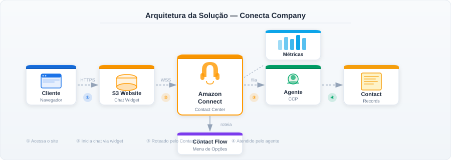
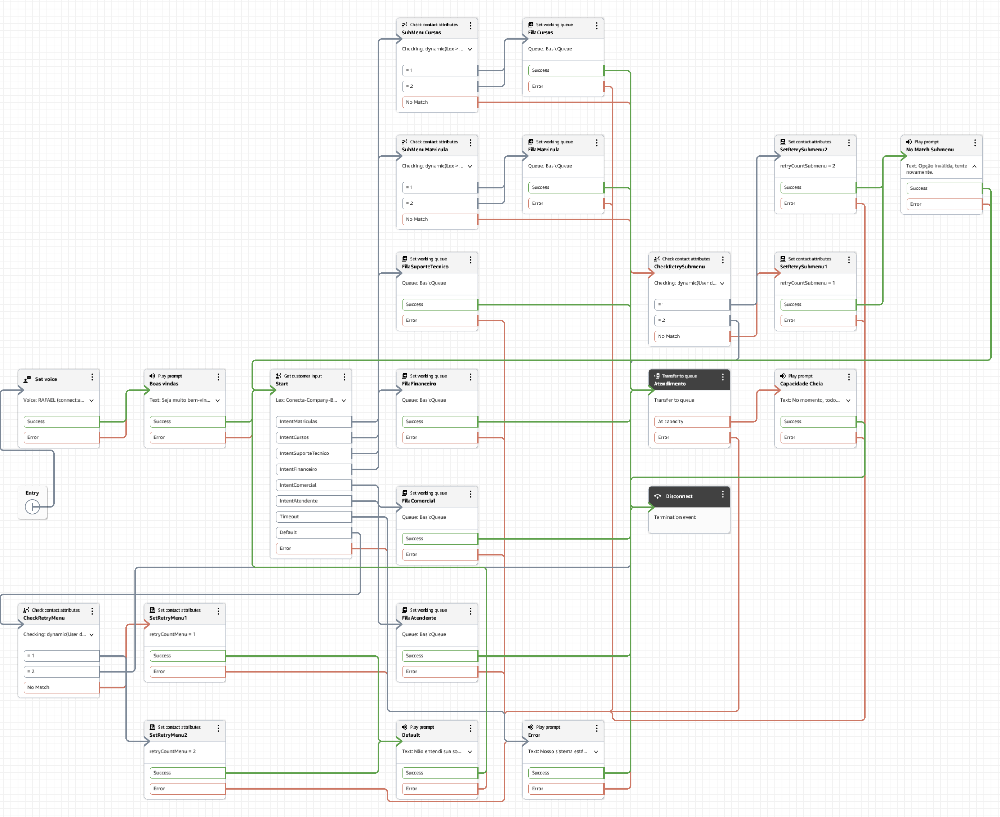
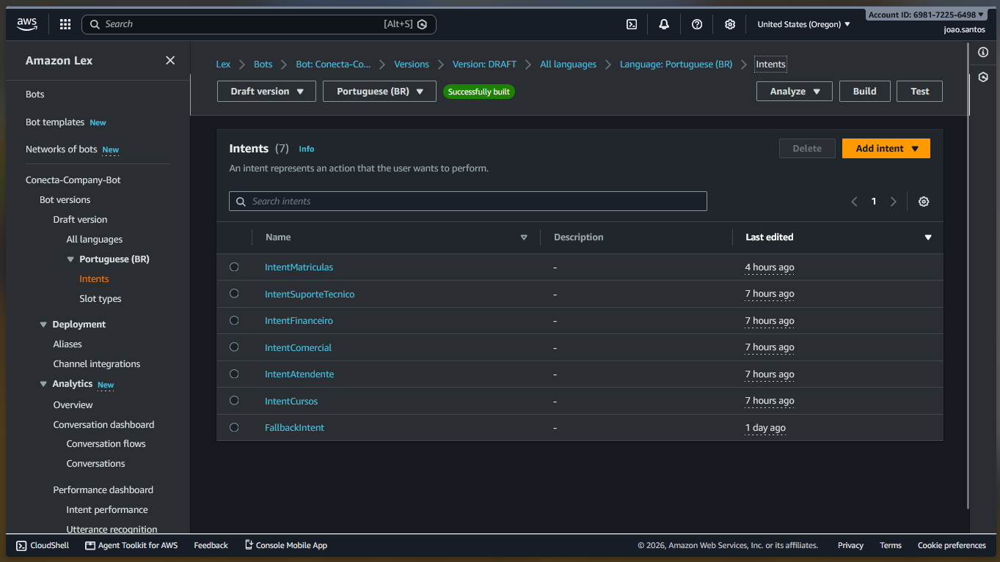

# Conecta Company - Atendimento via Chat com Amazon Connect e Lex V2

Este projeto implementa uma solução serverless de contact center em nuvem utilizando **Amazon Connect** e **Amazon Lex V2**. O sistema permite que clientes iniciem interações via chat em um site estático, naveguem por um menu de autoatendimento baseado em Processamento de Linguagem Natural (NLP) e sejam roteados para agentes humanos em filas específicas.

**🌐 Live Demo:** [Acessar o Frontend Hospedado no S3](http://conecta-joao.santos-site.s3-website-us-east-1.amazonaws.com)

## 🚀 Tecnologias e Serviços AWS Utilizados

*   **Amazon Connect**: Configuração de instâncias (`conecta-company-joao-coelho`), criação de filas dedicadas por departamento (Matrículas, Cursos, Suporte Técnico, Financeiro, Comercial), routing profiles e operação no painel Contact Control Panel (CCP).
*   **Amazon Lex V2**: Construção de bot conversacional com 7 intents customizadas (ex: `IntentMatriculas`, `IntentSuporteTecnico`, `IntentFinanceiro`). Implementação de submenus orientados a opções dinâmicas.
*   **Amazon S3**: Static Website Hosting para o frontend.
*   **HTML/JS**: Integração assíncrona do Communication Widget do Connect.

## 🏗️ Arquitetura e Roteamento (Contact Flow)

O Contact Flow foi desenhado para maximizar a retenção no autoatendimento. A arquitetura de decisão baseia-se no bloco `Get customer input` integrado ao Lex para interpretar as intenções do usuário antes de alocar recursos de atendimento humano.



### Fluxo de Decisão (Contact Flow)
O roteamento valida parâmetros dinâmicos e transfere o contato para as filas correspondentes, implementando também controle de repetições e *timeout*.



### Tratamento de Submenus (NLP)
O bot Lex foi configurado para interpretar linguagem natural e jargões corporativos e acadêmicos. Por exemplo, no submenu de Matrículas, o sistema reconhece sinônimos como "grade curricular", "o que vou aprender" e "carga horária" para acionar os fluxos de forma fluida, mitigando falhas por dependência exclusiva de inputs numéricos.



## 📊 Métricas e Evidências de Funcionamento

O diretório `/evidencias` contém os artefatos visuais que comprovam a operação fim a fim da arquitetura e a proficiência na gestão da plataforma AWS.

1.  **Vídeos de Demonstração (Walkthrough Técnico)**:
    *   **`demo.mp4`**: Apresentação técnica e guiada detalhando a configuração interna do console da AWS. O vídeo explora o provisionamento do **Amazon Lex V2** (Intents e Slots), a lógica visual de roteamento no **Contact Flow**, a simulação integrada de chat (Frontend para o CCP) e a exploração ao vivo dos painéis de métricas e rastreabilidade (Contact Search).
    *   **`Customer - Test chat.mp4`**: Documentação da navegação pelo menu principal e submenus do ponto de vista do usuário final, comprovando o tratamento de exceções e a transferência de contexto (transcript) para o agente humano.

2.  **Rastreabilidade e Métricas (Historical Metrics)**: 
    *   Múltiplos contatos foram registrados com sucesso (Contact Status: *Completed*).
    *   A inspeção detalhada (`DetalhesContato.png`) atesta o registro correto do canal (Chat) e fila de destino (`BasicQueue`).
    *   A fila principal operou com um *Service Level* de **95.00%** para SLA de 60 segundos (`Queue.png`), refletindo o tráfego gerado nos testes e a disponibilidade operacional da conta `agente01` (`Agents.png`).

## 📁 Estrutura do Repositório

```text
/
├── frontend/
│   ├── index.html 
│   └── styles.css
├── evidencias/
│   ├── screenshots/
│   │   ├── site_widget_minimizado.png
│   │   ├── SiteComChatWidgetVisível.png
│   │   ├── conversa_agente_cliente.png
│   │   ├── ConversaMatriculas.png
│   │   ├── ListaContatos.png
│   │   ├── DetalhesContato.png
│   │   ├── Agents.png
│   │   └── Queue.png
│   └── vídeos/
│       ├── demo.mp4
│       └── Customer - Test chat.mp4
├── docs/
│   ├── arquitetura.svg 
│   ├── fluxo-negocio-modulo2.png 
│   ├── contact-flow.svg 
│   ├── ContactFlowMenu.png 
│   └── BotAlexIntents.png 
└── README.md
```
